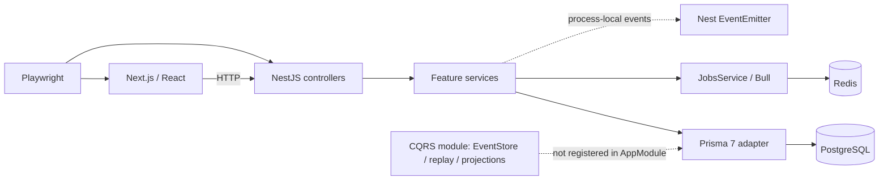

# Phase 03 — Architecture simplification

**Status: BLOCKED.** An additive v1 envelope was added to the existing CQRS domain-event path, with legacy event channels retained and old event rows defaulted to v1. Dependency removal was not safe to justify: there are no lockfiles or installed dependencies, the test suite cannot execute, and the source-reference scan is only heuristic. No module or dependency was removed. No outbox was added because the audited core job path has no same-transaction domain-row mutation, and the CQRS event store has no caller in the application source. These findings need runtime and product-owner validation before claiming the architecture acceptance criteria are met.

## Existing state and evidence

- The existing event contract had `eventId`, aggregate identity, event name, aggregate sequence `version`, `timestamp`, `payload`, and metadata, but no envelope protocol version (`backend-nest/src/cqrs/event-sourcing.service.ts:15-30`). `EventSourcingService.dispatch` runs handlers and emits typed, legacy catch-all, and new v1 channels (`:157-175`).
- The existing Postgres event store persists event identity/type, aggregate sequence, time, payload, and metadata (`backend-nest/src/cqrs/event-store.ts:57-94`; `backend-nest/prisma/schema.prisma:2974-2992`). Event replay reads records through `mapToEvent` (`backend-nest/src/cqrs/event-store.ts:258-276`).
- CQRS is defined as a dynamic module but has no `CQRSModule.forRoot` registration under `src`; the app module registers core feature modules without CQRS (`backend-nest/src/cqrs/cqrs.module.ts:40-70`; `backend-nest/src/app.module.ts:137-170`). No `eventStore.append(...)` call site was found under `backend-nest/src`.
- The core sync-job path loads an integration and then calls `JobsService.queueDataSync` (`backend-nest/src/integrations/integration.service.ts:237-250`). The job service performs Redis duplicate lookup and Bull add with three attempts (`backend-nest/src/jobs/jobs.service.ts:85-105`). That flow does not mutate a business row in the same transaction as publication.
- Other services emit process-local events, including IoT registration (`backend-nest/src/iot/iot-device.service.ts:71-106`), analytics ingestion (`backend-nest/src/analytics/analytics.engine.ts:108-133`), and notification delivery (`backend-nest/src/notifications/notification.service.ts:157-168,298-330`). A source search found no matching local subscribers for `iot.device.registered`, `finance.transaction.processed`, `analytics.metric.ingested`, or `notification.in-app`. Some are in-memory actions; the audit does not establish a requirement for durable delivery.
- Dependency manifests exist for backend, frontend, and E2E. No lockfiles or installed package trees are present, as recorded in Phase 02. Root `AGENTS.md` is absent. No code-owner/team mapping was found in this repository; the ownership table below reflects code boundaries only.

## Dependency graph and review

Read-only direct-source scan results (manifest dependency count / no-direct-reference candidates): backend **109 / 32**, frontend **73 / 10**, E2E **3 / 2**. The scan searched import/require string occurrences in source/config files. It cannot resolve type-only packages, CLI/config usage, transitive imports, dynamic requires, generated code, or platform tooling, so candidates are not findings. No package was removed or disabled. Before proposing removals, restore lockfiles and dependencies, run a proper dependency analyzer, inspect scripts/config/build outputs and package subpath use, compare installed production/development graphs, then run clean build/lint/unit/integration/E2E and compatibility checks.

## Service ownership table

| Code owner (module) | Responsibility | Persistence/publication boundary | Evidence |
|---|---|---|---|
| `PortalModule` / `PortalService` | Tenant portals, widgets, public share view | Prisma transaction/read; HTTP contract | `backend-nest/src/portals/portal.module.ts:1-13`; `portal.service.ts` |
| `IntegrationModule` / `IntegrationService` | Provider integrations and sync requests | Prisma read/write; delegates queue request | `backend-nest/src/integrations/integration.module.ts`; `integration.service.ts:237-250` |
| `JobsModule` / `JobsService` | Email, report, data-sync, analytics queues | Bull over Redis; retry/dedup policy | `backend-nest/src/jobs/jobs.module.ts:1-31`; `jobs.service.ts:45-129` |
| `CQRSModule` / `EventStore` / `EventSourcingService` | Event history, aggregate dispatch, replay | Prisma event log plus in-process emitter | `backend-nest/src/cqrs/cqrs.module.ts:40-70`; `event-store.ts`; `event-sourcing.service.ts` |
| Feature-local event producers | Analytics, IoT, notifications, industry modules | EventEmitter2, generally process-local | `backend-nest/src/analytics/analytics.engine.ts`; `src/iot/iot-device.service.ts`; `src/notifications/notification.service.ts` |
| Frontend | Dashboard/client UI and API client | HTTP to `/api/v1`; no event envelope consumer found | `frontend/src/lib/api.ts`; `frontend/src/app/` |
| E2E | Local browser/API contract flow | Playwright and disposable test services | `e2e/playwright.smoke.config.ts`; `e2e/tests/smoke.spec.ts` |

## Design / ADR

**ADR-03-01: additive, explicit event-envelope version.** Keep `DomainEvent.version` as the aggregate sequence number. Add `envelopeVersion: 1` as the independent serialization contract version. Add a v1 envelope projection with stable names and ISO time. Preserve existing event object fields, typed event name, and `domain.event` emission; add `domain.event.v1` as an opt-in channel. Persist the envelope version on event rows. Old rows are read as version 1, and the migration default backfills existing rows without rewriting payloads.

**ADR-03-02: no outbox without a demonstrated atomic publication requirement.** The audited core queue path publishes after an integration read and does not update domain state. The CQRS event store itself is the durable event log, has replay support, and currently has no application call site. Process-local producers have no matching subscribers in source. Adding an outbox/worker now would introduce an unowned retry, delivery, and retention contract without demonstrated consumers. If a future owning service must atomically save state and guarantee queue/event delivery, write that state and an outbox record in the same Prisma transaction; publish idempotently by stable event ID and mark delivery only after successful acknowledgement.

**ADR-03-03: do not remove dependencies based on text search.** No dependencies/modules were removed. The source heuristic cannot establish production irrelevance and no tests can run in this checkout. This phase records candidates for a later test-backed compatibility review only.

## Modified files

- `backend-nest/src/cqrs/event-sourcing.service.ts` — explicit envelope version, projection contract, additive v1 event channel; typed and legacy catch-all channels remain.
- `backend-nest/src/cqrs/event-store.ts` — persist/read envelope version; historic missing values map to v1; unknown versions fail clearly.
- `backend-nest/prisma/schema.prisma` and new `backend-nest/prisma/migrations/20261123170000_version_domain_event_envelope/migration.sql` — additive persisted field with default 1.
- New `backend-nest/src/cqrs/event-sourcing.service.spec.ts` and `backend-nest/src/cqrs/event-store.spec.ts` — envelope shape, legacy emission, and legacy row-read contract coverage.
- `e2e/tests/smoke.spec.ts` — asserts the unchanged sign-in HTTP status/envelope/user workspace contract during the agency/client smoke flow.
- `docs/architecture/current-system.md` — dependency/event notes; this report.

## Migration notes

The database diff is one nullable-free integer field with default: `ALTER TABLE "event_store_events" ADD COLUMN IF NOT EXISTS "envelopeVersion" INTEGER NOT NULL DEFAULT 1`. Existing rows receive 1 through the database default. No payload backfill, tenant data rewrite, or event replay is required. The migration has not been applied or validated because Prisma is unavailable.

Rollout order after validation: deploy the additive migration, deploy consumers that can read the existing fields plus `domain.event.v1`, then allow producers to emit v1. Existing consumers keep receiving the old event object on the original names. Rollback application code by stopping v1 emission and using legacy channels; leave the additive column in place. Do not drop the column or rewrite event history as a rollback action.

## API and UI contracts

- REST paths and UI contracts are unchanged in this phase. The E2E contract assertion protects existing `POST /api/v1/auth/signin`: HTTP 200, response envelope `success/statusCode/data`, access token, and workspace ID. The test change is in `e2e/tests/smoke.spec.ts` within the agency login step.
- Existing event contract remains: `eventId`, `aggregateId`, `aggregateType`, `eventType`, aggregate `version`, `timestamp: Date`, `payload`, and metadata.
- Additive event contract on `domain.event.v1`: `{ envelopeVersion: 1, eventId, eventType, occurredAt: ISO-8601, aggregate: { id, type, version }, data, metadata }`. The original typed channel and `domain.event` channel still emit the legacy-shaped event with an additional `envelopeVersion` field.
- No UI event consumer was found or changed. No API loading/error/empty states changed.

## Test commands and actual output

| Command | Exit | Result |
|---|---:|---|
| `git diff --check` | 0 | Passed; only existing Git LF/CRLF notices. |
| `docker compose -f docker-compose.test.yml config -q` (backend-nest) | 0 | Passed. |
| Inline Node source-reference heuristic over backend/frontend/E2E manifests | 0 | Read-only scan reported 109/32, 73/10, 3/2 declared/no-direct-reference-candidate counts; candidates are not proven unused. |
| `npm run build` (backend-nest) | 1 | Blocked: `'nest' is not recognized`. |
| `npm run lint` (backend-nest) | 1 | Blocked: `'eslint' is not recognized`. |
| `npm run test:ci -- --runTestsByPath src/cqrs/event-sourcing.service.spec.ts src/cqrs/event-store.spec.ts` (backend-nest) | 1 | Blocked: `'jest' is not recognized as an internal or external command`. |
| `npm run prisma:validate` (backend-nest) | 1 | Blocked: Prisma CLI is not installed. |

The migration, Prisma generated client, event tests, build, integration suite, API contract smoke, and UI were not executed. No successful verification is claimed. The Phase 02 report documents missing lockfiles/dependencies and the earlier blocked build/lint/E2E commands. No live provider keys are required for the added unit/contract tests; provider behavior is not part of this phase.

## Manual smoke steps

1. Restore deterministic backend/frontend/E2E lockfiles and dependencies from the approved registry/cache; install Playwright Chromium.
2. From `backend-nest`, run `npm run prisma:validate` and the focused event tests above.
3. Run the guarded fresh test DB workflow with loopback `TEST_DATABASE_URL`, `npm run test:integration`, and the Phase 02 E2E smoke command from `e2e`. Confirm the existing sign-in response contract, agency/client demo flow, and cross-tenant 403.
4. In a local test harness subscriber, listen to `domain.event.v1` and verify the event metadata/aggregate/data fields while a legacy subscriber on `domain.event` still receives the old fields. Do not connect a production event subscriber until its idempotency/privacy expectations are reviewed.

## Security, tenant, and data privacy

The new envelope carries existing event metadata and event payload. Do not place access tokens, refresh tokens, passwords, provider credentials, or unnecessary personal data in payloads or metadata. Workspace IDs should be included only where the producer already has an authorized workspace context; consumers must re-check tenant authorization before accessing records. This contract does not grant a consumer authorization and does not alter REST guards. The new event projection preserves the original payload reference; downstream consumers should treat it as immutable and avoid logging sensitive values.

No secrets were found or printed during this phase. No provider account, production event stream, production settings, or external system was contacted. Database migration and consumer rollout were not run.

## Unverified assumptions and blockers

- TypeScript/Jest/Prisma validation is blocked by missing installed dependencies. The schema/client field compatibility and migration SQL remain unverified by Prisma/PostgreSQL.
- `CQRSModule` is not registered in `AppModule` and has no `EventStore.append` call site. The v1 CQRS event path is therefore not demonstrated as an active runtime flow.
- The direct EventEmitter producers include post-write emissions, but no in-repo listeners were found for the inspected event names. Whether any external/runtime subscriber depends on guaranteed delivery is unknown. That uncertainty prevents a responsible outbox design or claim of at-least-once delivery.
- Dependency scan candidates are heuristic only. No package compatibility, bundle, licensing, or runtime removal tests were possible. Dependency load is unchanged.
- CI execution and the Phase 02 browser flow remain blocked until lockfiles/dependencies are restored.

## Exactly what must happen before Phase 04

1. Restore lockfiles/dependencies and run backend build/lint/unit tests, Prisma validation, fresh-database migration/integration tests, and the Playwright core API smoke; fix failures before rollout.
2. Decide whether the currently unregistered CQRS module is intended to be active. If yes, add an explicit module registration and consumer contract test in a separately scoped change; if no, schedule removal only after reference, migration, and compatibility evidence.
3. Identify any actual subscribers that require durable delivery. Add a transactional outbox only in the service that owns a state mutation and only when consumers require atomic state-plus-publication. Demonstrate retry, duplicate, stale lease, tenant denial, and rollback behavior before production use.
4. Run a test-backed dependency analyzer and compatibility review; remove nothing until every candidate has clean build/lint/unit/integration/E2E evidence and a rollback plan.

## Verification refresh — 2026-11-24

The earlier missing-dependency test results are historical. Prisma schema validation passed; the fresh disposable Postgres run applied all 12 migration directories including `20261123170000_version_domain_event_envelope`; backend build/typecheck passed; and focused envelope/event-store tests passed 2 suites/5 tests. Existing migration history was not rewritten beyond the documented query-index SQL repair; the new envelope column migration is additive with default 1. No dependency was removed. The architecture diagrams, ownership table, event ADR, heuristic dependency graph, and rollback notes remain applicable. No outbox was added because no same-transaction business write plus durable publication requirement has been established in the owning application flow.

The API smoke protects the local cookie-backed session and agency/client flow; the report's prior assertion that the sign-in JSON still includes `accessToken` is superseded by Phase 04's safer cookie contract. Current smoke asserts no token field in the session response and exercises replay/cross-tenant denial. The CQRS module remains unregistered and unused in the running app; event serialization is unit-tested but not an active runtime publication path. Full lint and the older general auth test harness remain blocked. No module/dependency removal, production DB migration, provider access, or rollout was performed.

**Before Phase 04:** local schema/build/event/API smoke gates have passed. Keep the unregistered event path and outbox question as an explicit architecture decision; do not claim production delivery guarantees. For a clean CI baseline, resolve repository-wide lint and legacy test-loader failures, then add the dedicated local smoke to a non-deploying CI job.

## Latest verification and status — 2026-11-24

Clean installs passed for backend, frontend, and E2E. Prisma validate and fresh disposable DB migration/seed/integration passed; the additive envelope migration was applied on that disposable DB. Focused event-store/envelope tests passed within the 5-suite/15-test auth+event run. Backend build/typecheck passed. The agency/client smoke also exercises the current cookie auth contract and passed locally after the setup lifecycle was consolidated. No module or dependency was removed; the event CQRS module is still unregistered, so the envelope path remains unit-tested rather than a production event flow. No transactional state-plus-publication requirement was established; no outbox was added.

The CI workflow test job is added but has not run on GitHub. Full lint and the older auth test harness remain failing. A package review also left an npm Apollo peer warning (`@apollo/server` 5 with the GraphQL Playground 4 peer) for separate compatibility review; production builds and focused tests pass locally. Phase 03 is **BLOCKED for hosted CI/runtime assurance**, not for its local schema/build/event tests.

