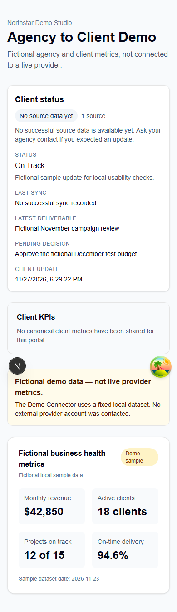
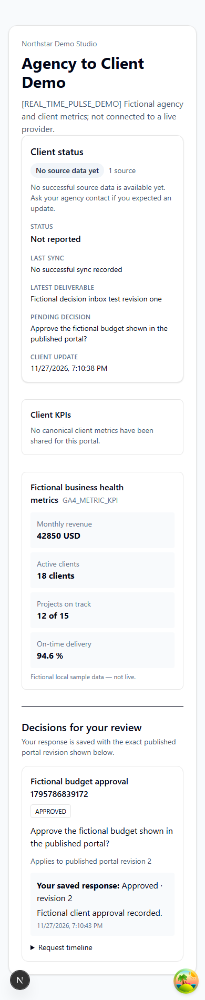

# Phase 22 — Design system and accessibility

**Status: PASS** — seeded browser checks demonstrate the keyboard path from sign-in through portal publication and client approval, reduced-motion support, visible focus, acceptable focus contrast, mobile overflow and cumulative layout shift. A manual screen-reader/browser matrix remains unverified and is called out below.

## Existing implementation and evidence

- Before this phase, `frontend/src/app/globals.css:17-25,39-53,69-78` set the body in Arial while defining Geist font tokens, used purple `#a855f7` with white foreground in light and dark themes, and let OS `prefers-color-scheme` override the explicit class-based theme. There was no shared visible-focus or reduced-motion rule.
- The root layout and existing providers were already present (`frontend/src/app/layout.tsx:109-126`, `frontend/src/app/providers.tsx:62-82`): Next 16 route announcements were available, and the app theme provider used class-based light/dark modes.
- Login already had labelled email/password fields and loading/rate-limit handling (`frontend/src/app/auth/login/page.tsx:22-93,167-257`), but field errors lacked `aria-invalid`/descriptions, server errors were not announced, the password visibility control had no accessible name, and the page heading was an `h2`.
- The portal builder already supported draft/published snapshots and keyboard move buttons (`frontend/src/app/dashboard/portals/[id]/edit/page.tsx:75-122,139-170`). Decision inbox and the client approval panel already had loading, error and stale-revision states (`frontend/src/app/dashboard/decision-inbox/page.tsx:136-176`, `frontend/src/components/client-portal/ClientDecisionPanel.tsx:25-98`). The public summary reports stale/no-data states (`frontend/src/components/client-portal/ClientPortalSummary.tsx:4-57`).
- `e2e/tests/smoke.spec.ts` already used the fictional Northstar/Juniper fixtures from `backend-nest/prisma/seed-test-fixtures.ts:24-53,193` and tested portal publication, client view, tenant denial and decision revision rules. Before this phase the decision flow used pointer clicks; the portal smoke also attempted to add another widget beyond the demo plan allowance.

## Design decision and scoped plan

Keep the existing design system and portal/decision modules. Improve shared tokens and keyboard affordances; add accessible field/error/loading announcements to existing components; drive the existing portal and approval UI with keyboard-only E2E helpers; use the repository's seeded fictional records for before/after screenshots. No schema, service or API changes were needed.

Token choices: use the app's explicit class-based theme rather than letting the OS preference override it; light primary `#6b21a8` with white foreground; dark primary `#c084fc` with `#1f1233` foreground; light focus ring `#1d4ed8`; dark focus ring `#fbbf24`. Calculated contrast ratios are 8.72:1 and 6.66:1 for primary/foreground, and 6.70:1 and 11.86:1 for focus/background in light and dark. Global focus outline is 3px. Reduced-motion preferences reduce animation and transition durations to 0.01ms.

## Modified files and artifacts

- `frontend/src/app/globals.css` — align body/headings with existing font tokens; use higher-contrast light/dark primary colors; add 3px focus outlines and reduced-motion rules.
- `frontend/src/app/auth/login/page.tsx` — use a page-level heading, associate field errors, announce server/rate-limit errors, label the password toggle, and expose a screen-reader loading label. The rate-limit countdown now updates from state rather than reading the clock during render.
- `frontend/src/components/client-portal/ClientDecisionPanel.tsx` — announce loading/saving, preserve accessible retry/error status and give response actions 44px minimum height.
- `e2e/tests/smoke.spec.ts` — add keyboard navigation helpers; verify keyboard sign-in, onboarding demo creation, builder publication, decision creation and client approval; check focus visibility/contrast, reduced motion, 320/360/390px overflow and mobile CLS. The broader builder smoke now uses the demo's seeded widgets (and reorders only when multiple exist) instead of attempting a new over-limit widget.
- Seeded screenshots: [before portal view](assets/22-before-client-portal.png) and [after approval](assets/22-after-client-approval.png). Both show the fictional Northstar demo at 390px width. The first is the seeded client status view; the second adds the saved decision response and timeline state.

## Schema, API and UI contracts

- Schema and API contracts are unchanged; no migration, new endpoint, event or server setting was added.
- Login continues using the same authentication and safe `returnTo` behavior. Form field names and requests are unchanged.
- The client decision API still responds against the exact published revision. UI loading/error/empty/stale behavior remains in the existing components; this phase adds announcements and keyboard access without changing response payloads.
- E2E uses the repository's isolated `pulse_test` database and fictional fixture identities (`.invalid` domains). It uses the UI for login, portal publication, decision creation and approval; test setup assigns the demo share link through the local API.

## Verification commands and actual results

- From `e2e`, with PowerShell environment values `TEST_POSTGRES_PORT=16434` and `TEST_REDIS_PORT=17380`:
  - `npm run test:smoke -- --grep "decision inbox records one versioned client response"` — **exit 0**, 1 Playwright test passed. Its database setup also passed 3 suites / 4 tests. It covers keyboard login, demo creation, builder publication, client approval, response refresh, focus outline/contrast in light/dark, reduced motion and CLS ≤ 0.1 at mobile width, plus 320/360/390px document-width checks.
  - `npm run test:smoke -- --grep "agency creates persistent client portal"` — **exit 0**, 1 Playwright test passed (47.1s test; 2.0m including local setup). It covers poor-network loading, public client status, mobile preview, broken-connector fallback, private-field exclusion, retry behavior and cross-tenant denial. Database setup also passed 3 suites / 4 tests.
- `cd frontend; npm run typecheck` — **exit 0** (sequential run after build generation).
- `cd frontend; npm run build -- --webpack` — default sandbox attempt **exit 1** on generated `.next` directory permission; authorized local retry **exit 0**, production compilation, TypeScript and all 63 static pages completed. Plain `npm run build` using Turbopack exited 1 because its CSS worker process could not be created in this Windows environment. The Webpack build is the successful production-build result.
- Targeted ESLint for `auth/login/page.tsx` and `ClientDecisionPanel.tsx` — **exit 0**, 0 errors, 6 warnings (long component functions, existing React Hook initial fetch pattern, OAuth navigation and React Hook Form prop spreading).
- `git diff --check` — **exit 0**; Git emitted existing LF/CRLF normalization warnings for earlier worktree changes.

The final screenshots were captured from the passing seeded E2E. The local run may log expected OAuth-not-configured and Redis shutdown messages; the smoke app did not use external OAuth or provider accounts.

## Accessibility checks and documented exceptions

- Keyboard-only E2E traverses and submits the login form, creates the demo through onboarding, edits/publishes a portal, creates a decision request, and approves the exact published version. It checks the focus outline is 3px and its contrast is at least 3:1 in light and dark themes.
- Browser checks honor `prefers-reduced-motion`, enforce mobile cumulative layout shift ≤ 0.1, and ensure no horizontal document overflow at 320, 360 and 390px widths.
- Login errors, decision loading/saving, stale state and retry paths use status/alert semantics. The broader smoke uses a delayed response to verify a meaningful loading message and a mocked failed connector to verify its unavailable state.
- No NVDA, VoiceOver, TalkBack or Safari manual review was run. No full WCAG certification or axe scan is claimed. Screenshots include Next development indicators at the bottom corners; they are browser tooling, not product UI.
- OAuth buttons require configured external accounts and were not tested; local email/password fixture login was used. Real client data and live providers were not used.

## Security, tenant and privacy review

This phase adds no API authorization or data access paths. The passing broad smoke verifies the client cannot read another workspace's portal and that private connector fields do not enter preview. Approval uses the assigned fictional client and exact revision. Screenshots contain only synthetic Northstar data, no share URL, password, secret, real email or provider payload.

## Rollback and migration safety

There is no migration or server contract to roll back. Revert the three UI/test source changes to restore the previous visual behavior, and remove the two screenshot assets if the phase is reverted. No production settings or services were changed.

## Unverified assumptions and next phase

- The CSS token contrast calculations and browser focus outline were checked, but manual assistive-technology review is still needed for route announcements, login errors, decision status and the mobile client view.
- Browser coverage here is seeded Chromium on desktop/mobile viewport sizes, not Safari/Firefox or a physical device. CLS was measured on the mobile client route used by the approval journey.
- Before Phase 23, run a short NVDA or VoiceOver review across login → publish → approve, verify the error/retry announcements, then add any resulting exception to the shared component guidance. Keep the two seeded screenshots as the design baseline.
