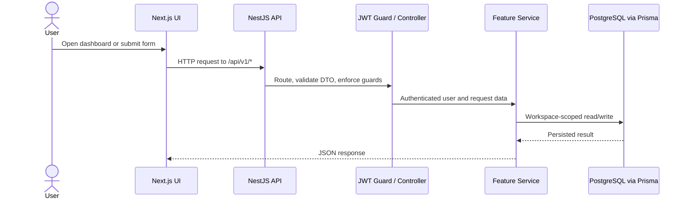
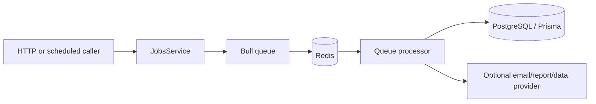
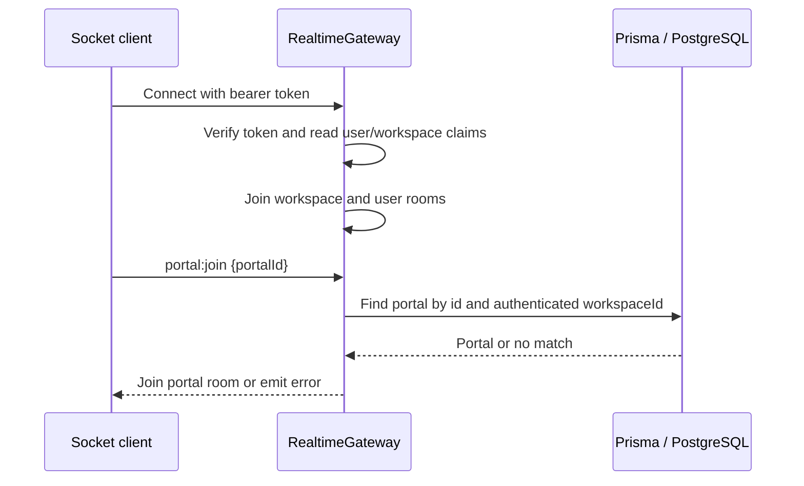
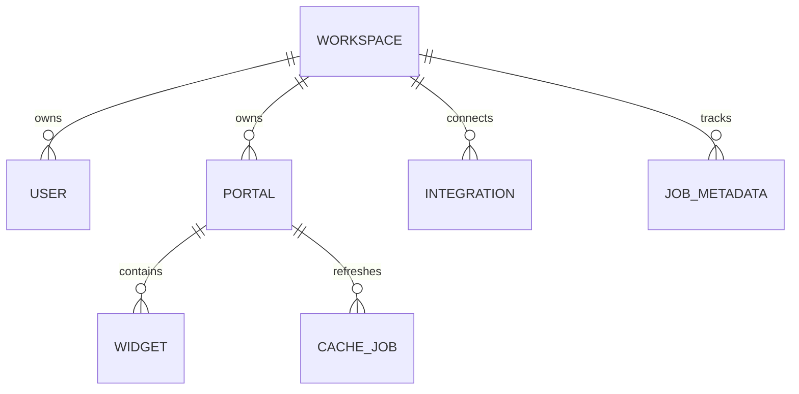
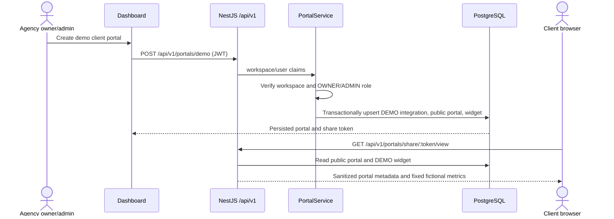

# Current system architecture

This diagram records the paths evidenced in the current source, not a claim that all external integrations are configured. The API uses `/api/v1` routing (`backend-nest/src/main.ts:116-123`).

## HTTP request path

Evidence: global prefix/version/validation in `backend-nest/src/main.ts:95-123`; auth route in `backend-nest/src/auth/auth.controller.ts:173-180`; workspace controller/service in `backend-nest/src/workspaces/workspace.controller.ts:32-55` and `backend-nest/src/workspaces/workspace.service.ts:37-47`.

## Background job path

Evidence: queue wiring in `backend-nest/src/jobs/jobs.module.ts:14-32`, queue injection and attempts in `backend-nest/src/jobs/jobs.service.ts:36-39,47-54`, processors in `backend-nest/src/jobs/processors/`. Provider behavior depends on configuration and was not live-tested.

## Realtime path

Evidence: `backend-nest/src/realtime/realtime.gateway.ts:103-146,183-211`. This documents portal-join authorization; it does not establish that every socket message handler independently checks resource tenancy.

## Data ownership

Evidence: `backend-nest/prisma/schema.prisma:16-55` (User belongs to Workspace), `:129-199` (Workspace/Subscription), `:256-295` (Integration), `:418-515` (Portal/Widget), `:557-578` (CacheJob), and `:755-787` (JobMetadata). Relations are abbreviated to the core dashboard flow.

## Local topology

`backend-nest/docker-compose.yml:1-41` starts only opt-in local Postgres and Redis services with health checks, persistent named volumes, and loopback port binds. The API runs on the host. `backend-nest/docker-compose.test.yml` defines separate test-only Postgres and Redis containers with health checks and no volumes. Production deployments are not described by these compose files.

## Fictional demo agency-to-client path

The public view returns only selected workspace fields, widget metadata, and deterministic demo metrics; it does not serialize integration settings or credentials (`backend-nest/src/portals/portal.service.ts:146-190`). The agency-to-client smoke passed locally against a disposable database; broader data-privacy and hosted deployment behavior remain unverified.

## Domain event envelope

`DomainEvent.version` continues to mean aggregate sequence. `envelopeVersion` is a separate protocol version. New v1 envelopes carry `eventId`, `eventType`, ISO `occurredAt`, aggregate identity/version, `data`, and `metadata`; existing typed and `domain.event` emissions retain their prior object shape. The additive `domain.event.v1` channel is available from `EventSourcingService.dispatch`. Existing persisted event rows default to envelope version 1 on migration/read.

This CQRS implementation is not currently wired into `AppModule` and no call site for `EventStore.append` exists in `src` (`backend-nest/src/app.module.ts:137-170`; search result for `eventStore.append`: none). The current core queue path only adds Bull jobs after reading the integration; no same-transaction business-row write was found in that path (`backend-nest/src/integrations/integration.service.ts:237-250`; `backend-nest/src/jobs/jobs.service.ts:85-105`). Therefore this phase does not add an outbox or imply reliable delivery for the separate direct `EventEmitter2` emissions. If a production workflow requires a persisted state change and reliable external job/event publication to commit together, add an outbox in that owning service before wiring the subscriber.
